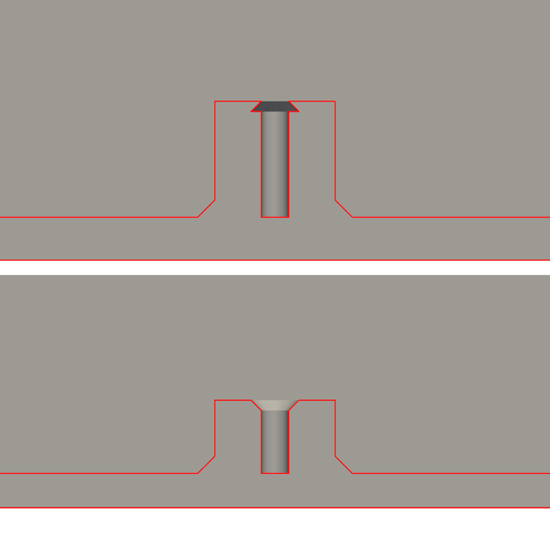

import { Aside } from "@astrojs/starlight/components";

This guide builds the case for auspex, an open 5x12 ortholinear Hall-effect keyboard ([series hub](/reference/auspex-hall-effect-keyboard/)), as Python in build123d, from facts read out of the KiCad board file. Every build then runs a check script that has to pass before a file goes to a vendor. The second half covers a printability gate the first upload did not have: a resin fit print went to JLC3DP with an undercut under every screw boss, every boolean check passed it, and the vendor's engineering review caught it. The checks and the section render described here would have caught it first.

Prerequisites: KiCad (its `pcbnew` Python module reads the board), `uv` for the build123d and mesh environments, and a routed `.kicad_pcb`. The typing-height research behind the vertical stack is in [Keyboard typing height](/reference/keyboard-typing-height/); this guide uses its result and does not repeat it. How the PCB itself is generated and gated is in [A PCB as code, and proving its checks](/reference/pcb-as-code-verification/).

## Constants (read this first)

Every number below is read from the case source or its README at the time of writing. The case is rebuilt from the board, so these move when the board moves.

### The case as built

| Item | FDM / SLA case | CNC aluminium case |
|---|---|---|
| Outer footprint | 237.6 x 104.25 mm (PCB 230.60 x 97.25 + 0.5 clearance + 3.0 wall each side) | 267.6 x 134.25 mm (18.0 mm walls) |
| Height | 13.86 mm | 13.86 mm |
| Wall / floor | 3.0 / 2.0 mm | 18.0 / 2.0 mm |
| Standoff (floor top to PCB bottom) | 4.26 mm = USB-C receptacle 3.26 mm + 1.0 mm clearance | same |
| z stack (case bottom = 0) | floor 2.0, PCB 6.26-7.86, plate 11.26-12.86, wall top 13.86 | same |
| Mass | 72.5 cm3 (about 90 g PLA) | 130.6 cm3 6061 (about 353 g) + brass ring 83.7 cm3 (about 712 g) |
| Mounts | 5 bosses, M2 heat-set insert (3.3 mm bore) or M2 self-tap (1.6 mm bore) | 5 bosses, M2x0.4 tapped |

### Fixed by standards or vendors

| Constant | Value | Source |
|---|---|---|
| MX plate top to PCB top | 5.0 mm | MX switch/plate spec, as recorded in `case.py` |
| USB-C plug overmold, maximum | 12.85 x 7.0 mm | USB Type-C compliance document rev 1.2 Fig B-1 (12.35 x 6.5), relaxed by the 2023-08 ECN |
| USB-C overmold, widest real cable seen | 13.0 x 7.4 mm | recorded in `case.py` on 2026-11-04, with the plug-window check |
| JLC3DP resin minimum wall | 0.8 mm at 10 x 10 mm, 2.0 mm at 200 x 200 mm; over 1.5 mm for fasteners | JLC3DP design guideline[^jlc-guide] |
| 6 mm end mill inside corner | R3.0 | the cavity tool on the CNC variant |

### Component versions

The outputs are committed and CI rebuilds them byte for byte, so the CAD kernel is pinned like a compiler:

| Component | Version |
|---|---|
| build123d | 0.13.0 |
| cadquery-ocp-novtk (OCCT, writes the STEP/STL bytes) | 8.0.1.1.0 |
| Python | 3.13 |
| Mesh checks | trimesh with rtree, scipy, networkx, embreex (unpinned; they read meshes, they do not write outputs) |

## Architecture overview

Two inputs feed the case. `tools/geom.py` is the intended planar geometry the PCB pipeline also imports (outline, key centres, mount holes, USB centre). `board-facts.json` is what the routed board really contains, extracted by `board.py`. The case is built from the facts, and the check script asserts the facts agree with `geom` on everything they share, so a placement change that never reached `geom.py` fails the build.

```dot
digraph {
  rankdir=LR; bgcolor="transparent"; nodesep=0.3; ranksep=0.7;
  fontname="Helvetica,Arial,sans-serif";
  node [fontname="Helvetica,Arial,sans-serif", fontsize=11, shape=box];
  edge [fontname="Helvetica,Arial,sans-serif", fontsize=9];
  pcb [label=".kicad_pcb\n(routed board)"];
  facts [label="board.py\n-> board-facts.json"];
  geom [label="tools/geom.py\n(intended geometry)"];
  height [label="height.py\n(desk-to-keytop model)"];
  case [label="case.py\n(build123d)"];
  out [label="STEP / STL / DXF\nin out/"];
  check [label="check.py\n(collisions, fit, DFM)"];
  ci [label="CI: rebuild +\ngit diff out/"];
  pcb -> facts [label="pcbnew"];
  facts -> case;
  geom -> case;
  case -> out;
  out -> check;
  facts -> check;
  geom -> check;
  height -> check;
  out -> ci;
}
```

1. `board.py` reads the routed `.kicad_pcb` with `pcbnew` and writes `board-facts.json`.
2. `case.py` builds the case solids from the facts and `geom.py`, and exports STEP, STL and the plate DXF into `out/`.
3. `check.py` rebuilds the solids, intersects them with the board's parts and bodies, runs the height model from `height.py`, and runs the printability checks on the exported STL.
4. CI rebuilds every variant from the board files and fails if any tracked file in `out/` changes.

## Part 1: read the board facts from the KiCad file

The case never retypes a board dimension. `mechanical/case/board.py` runs under the system `python3` (where KiCad installs `pcbnew`) and extracts:

| Fact | How it is read |
|---|---|
| PCB outline | bounding box of the `Edge.Cuts` drawings, minus half the drawing line width |
| Mount holes | every `MountingHole*` footprint: position and drill diameter |
| USB-C receptacle | position, side, body box from the Fab layer, courtyard box, height |
| Bottom-side parts | every flipped footprint: package, bounding box, height from a table |
| MX switches | front-side `MX-*` footprints: the plate cutout centres |

The mount hole reader, close to verbatim (the source sorts `out` in place before returning it):

```python
MM = 1e6  # KiCad internal units are nanometres

def mount_holes(board):
    out = []
    for f in board.GetFootprints():
        pkg = str(f.GetFPID().GetLibItemName())
        if not pkg.startswith("MountingHole"):
            continue
        drills = [p.GetDrillSize().x / MM for p in f.Pads() if p.GetDrillSize().x > 0]
        out.append({"ref": str(f.GetReference()),
                    "x": f.GetPosition().x / MM, "y": f.GetPosition().y / MM,
                    "drill": max(drills) if drills else 0.0})
    return sorted(out, key=lambda h: h["ref"])
```

Component heights are the one thing a KiCad footprint does not carry reliably, so `board.py` holds a `PACKAGE_HEIGHT` table of "maximum height above the PCB face" per footprint name. Each entry is labelled FETCHED (a manufacturer or distributor page was read) or RECALLED (the JEDEC/IPC package maximum the footprint name encodes, not re-checked against a source). The tallest recalled entry is the LQFP-64 MCU at 1.60 mm, 1.66 mm below the 3.26 mm USB-C body, so no recalled number can set the standoff; they are to be replaced with fetched figures before metal is ordered. A footprint that is not in the table is reported in `unknown` and fails the check; it is never guessed.

## Part 2: the vertical stack

The standoff is computed from the board: it is the tallest bottom-side part that is not over a floor opening, plus `COMPONENT_CLEARANCE` (1.0 mm). On this board that part is the USB-C receptacle at 3.26 mm, so the standoff is 4.26 mm. The SWD header is taller (4.25 mm) but sits wholly over its own floor opening, so `exempt_parts()` drops it from the standoff and a separate check keeps it inside that opening with a 1.5 mm margin.

```python
def stack(facts):
    exempt = exempt_parts(facts)
    counted = [p for p in facts["bottom_parts"]
               if p["height"] is not None and p["ref"] not in exempt]
    tallest = max(p["height"] for p in counted)
    floor_top_z = FLOOR_T
    pcb_bottom_z = floor_top_z + tallest + COMPONENT_CLEARANCE
    pcb_top_z = pcb_bottom_z + PCB_THICKNESS
    plate_top_z = pcb_top_z + PLATE_DISTANCE        # 5.0 mm, MX spec
    wall_top_z = plate_top_z + PLATE_ABOVE_WALL
    ...
```

A new taller part anywhere else on the board raises the case by itself on the next build. `height.py` adds the keycap profiles, switch seat and rubber pads on top of this stack and prints a desk-to-keytop table; why the target is a low, flat home row and what the ergonomics literature says about it is the subject of [Keyboard typing height](/reference/keyboard-typing-height/). The stack above is what made it reachable: the floor went from 10 mm to 2 mm once the brass weight moved out from under the cavity (Part 3).

## Part 3: FDM/SLA and CNC variants from one source

One `case.py` builds every variant. The process is an environment variable:

```bash
make case                                  # FDM case, heat-set insert bores
GRIDLOCK_CASE_PROCESS=cnc make case        # CNC aluminium case + brass ring (STEP only)
make case-print                            # resin upload: self-tap bores, case-selftap.stl
```

Only the floor and the features a process needs differ; everything above the floor top follows the same stack.

| Feature | FDM / SLA | CNC |
|---|---|---|
| Walls | 3.0 mm | 18.0 mm, grown outward, cavity unchanged |
| Boss bore | 3.3 mm (heat-set) or 1.6 mm (self-tap), 0.6 mm entry chamfer | 1.6 mm tap drill, M2x0.4 tapped 4.0 mm |
| Cavity corners | rounded | sharp rectangle plus R3.0 dog-bone reliefs |
| Mass | none | brass ring in a pocket in the walls |
| Outer edges | 0.5 mm bed-contact chamfer against elephant foot | 0.5 mm edge break top and bottom, for anodising |

### Dog-bone corner reliefs for a sharp-cornered PCB

The PCB and the plate are sharp-cornered rectangles, 0.5 mm inside the cavity walls, and both were already ordered when the CNC variant was drawn (the PCB order is covered in [the JLC order guide](/guides/jlc-4-layer-pcba-keyboard-order/)). A 6 mm end mill leaves an R3.0 inside corner. A sharp corner clears an R3.0 corner only from an inset of 3.0 x (1 - 1/sqrt2) = 0.88 mm, so the first CNC cavity put 0.54 mm of aluminium into each board corner (1.96 mm3 over the four) while every check at the time passed.

The fix keeps the cavity a sharp rectangle and adds one tool-radius circle per corner, centred on the corner diagonal 2.12 mm from each wall, so the circle's edge passes through the sharp corner: the end mill plunges along the diagonal. The straight walls still sit 0.5 mm off the PCB and plate edges, and each relief overcuts its walls by 0.88 mm. The README tells the shop the reliefs are intentional, because replacing them with a plain R3 fillet brings the collision back.

### The brass weight, moved into a wall ring

The first heavy design put a 7.3 mm brass plate in a pocket under a 10 mm floor. Every millimetre of floor is a millimetre of keytop height, and that stack put every keycap profile over the 35 mm limit the height model enforces. The brass is now a C-shaped ring in a pocket milled up into the walls from below, its underside flush with the case bottom, open at the USB plug window. It measures 263.2 x 129.9 x 9.66 mm (83.7 cm3, about 712 g) and is held by 7 M3 countersunk screws from below into blind M3x0.5 holes in the 4.0 mm of aluminium above the pocket. Because the ring sits beside the cavity, it adds mass without height. The pocket's inside corners are R3.0 like the cavity's, so the ring is modelled with matching corners rather than as a sharp box that a 6 mm end mill could not seat.

## Part 4: the check script

`check.py` runs after every build. A failing line exits 1; NOTE lines record design rules the script does not assert. The collision checks intersect the built solid with real bodies, so they test the generated geometry rather than the parameters that produced it.

### Collisions with every bottom-side part

Each bottom-side footprint becomes a box (its bounding box, extruded down from the PCB underside by its table height), and the volume of case material inside it must stay under 1 mm3:

```python
for p in facts["bottom_parts"]:
    bb, h = p["bbox"], p["height"]
    env = Box(bb[2] - bb[0], bb[3] - bb[1], h,
              align=(Align.MIN, Align.MIN, Align.MIN)).moved(
                  Location((to_case_x(bb[0]), to_case_y(bb[3]), pcb_bottom_z - h)))
    if (body & env).volume > 1.0:
        collisions.append(p["ref"])
```

The same pattern covers the PCB body (the as-built outline, sharp corners, at the PCB's z) and the plate body (read from the plate project's `Edge.Cuts`). Those two are the checks that failed at 1.964 mm3 each on the R3.0 cavity once they were added.

### The USB cable plug envelope

The receptacle body fitting its wall notch is not enough: a cable's overmold is larger than the receptacle and enters the wall. The first version of the case had a notch sized for the receptacle body only. The receptacle mouth sits 1.95 mm inside the outer wall face, so the overmold would have hit the wall above the notch about 2 mm before mating: 55 mm3 of wall in a maximum-size overmold's path, 22 mm3 for a slim cable. That was found by intersecting the overmold with the case on 2026-11-04, and the plug window was added before the fit print was ordered. The check intersects the case with two boxes centred on the receptacle, from its mouth to 5 mm past the outer wall face: the USB-IF maximum (12.85 x 7.0 mm) and the widest real cable seen (13.0 x 7.4 mm). Each must hold under 0.5 mm3 of case material. One mutation run proves it bites: starting the plug window at the floor top, as an earlier revision did, fails both envelopes with 21.80 and 27.12 mm3 of floor in the plug path.

### Millable inside corners

For the CNC solid, the script walks every vertical edge and every partial vertical cylinder face. A straight vertical edge with material on more than 60 % of a 0.05 mm disc round its midpoint is a sharp concave corner (a concave corner has 75 %, a flat face 50 %, a convex corner 25 %) and cannot be cut by a rotating tool at all. A concave arc must have a radius at least that of the tool that reaches it: R3.0 in the cavity and the ring pocket, R1.5 for the smaller through-features. Full cylinders are drilled holes and exempt. On the geometry the review flagged, this check found 10 sharp concave edges.

### Deterministic outputs, diffed in CI

With the toolchain pinned, a second `make case` rebuilds byte-identical STEP and STL files. The CI job rebuilds the FDM, CNC and self-tap print cases from the board files and fails on any change or untracked file under `mechanical/case/out`:

```bash
make case
GRIDLOCK_CASE_PROCESS=cnc make case
make case-print case-test
git diff --stat --exit-code -- mechanical/case/out
test -z "$(git ls-files --others --exclude-standard -- mechanical/case/out)"
```

A board change whose case outputs were never rebuilt fails that diff, and a build123d or OCCT version bump becomes a deliberate commit: bump the pin, rebuild, commit the outputs.

## Part 5: the printability gate

### What the vendor found

The resin fit print went to JLC3DP as `case-selftap-v2.stl`. Their engineering review flagged 0.51 mm walls at all 5 boss tops (and warping risk on a long flat tray, accepted for a fit check). The cause was one line: the `PILOT_CHAMFER` cone had its radii swapped. An entry chamfer must be wide at the top face; this one was narrow at the top and 0.6 mm wider at the bottom, so it cut an undercut under each boss face. The bore measured 1.6 mm at the face and 2.8 mm 0.6 mm below it, and the self-tap screw would have bitten into a knife-edge lip.

```python
# Fixed: wide end UP, so the chamfer opens at the boss top face.
body -= Cone(bottom_radius=pilot_d / 2,
             top_radius=pilot_d / 2 + PILOT_CHAMFER,      # the bug had these two swapped
             height=PILOT_CHAMFER + 0.01,
             align=(Align.CENTER, Align.CENTER, Align.MIN)).moved(
                 Location((cx, cy, pcb_bottom_z - PILOT_CHAMFER)))
```

### Why the boolean checks passed it

Every check in Part 4 looks for case material where something else must go: a part, the PCB, a cable. The undercut was the opposite defect, material missing inside the case's own solid, and nothing intersected that region with anything. A volume check does not help either: the inverted and the correct chamfer are mirrored frustums of equal volume. Built on the synthetic 7 mm boss from `test_dfm.py` (1.6 mm bore, 0.6 mm chamfer), they come to 221.715 and 221.756 mm3; the 0.04 mm3 difference is the 0.01 mm the cutter cone overlaps the top face, which falls at the narrow end on one and the wide end on the other. And the outside views looked correct, because the undercut is internal.

So the gate has to look at the shape of the material itself: how thick it is, and whether a bore gets wider below its entry.

### Wall thickness by inward-normal rays

For each sample point on the surface, cast a ray along the inward normal and measure the distance to the next surface hit. The samples are every triangle centroid plus area-weighted random points. This is the core loop, adapted from the project's `dfm.py` and run against both a good and an inverted boss for this guide:

```python
import sys
import numpy as np
import trimesh

def min_wall(path, floor_mm=0.8, samples_per_mm2=0.5):
    m = trimesh.load(path, force="mesh")
    assert m.is_watertight, "wall thickness is undefined on an open mesh"
    sp, sf = trimesh.sample.sample_surface(m, int(m.area * samples_per_mm2), seed=1)
    P = np.vstack([m.triangles_center, sp])                 # every face centroid + area samples
    N = m.face_normals[np.concatenate([np.arange(len(m.faces)), sf])]
    o = P - N * 1e-4                                        # start just inside the skin
    loc, ray, _ = m.ray.intersects_location(o, -N, multiple_hits=False)
    t = np.full(len(P), np.inf)
    t[ray] = np.linalg.norm(loc - o[ray], axis=1)           # distance to the far wall
    thin = np.where(t < floor_mm)[0]
    return [(round(float(t[i]), 3), P[i].round(2).tolist()) for i in thin[np.argsort(t[thin])]]

hits = min_wall(sys.argv[1])
print(len(hits), "samples under 0.8 mm", hits[:5])
sys.exit(1 if hits else 0)
```

```bash
uv run --no-project --python 3.13 --with trimesh --with rtree --with scipy --with embreex \
    python minwall.py case-selftap.stl
```

On the synthetic pair it reported 633 samples under 0.8 mm on the inverted boss (worst 0.003 mm at the top face) and none on the correct one. On the current `case-selftap.stl` it prints `0 samples under 0.8 mm []` and exits 0. The command checks whatever upload file `make case-print` last wrote; to reproduce the before/after comparison, run it on the archived v2 and v3 meshes instead.

Why it has no false positives at edges: a ray along the inward normal of a face runs parallel to any adjacent face that meets it at 90 degrees, so plain box corners, fillets and 45-degree chamfers (135 degrees inside) never read thin. Only a wedge sharper than 90 degrees does: a knife edge, a true thin wall, or the 45-degree roof of an inverted chamfer cone. On that wedge the reading falls to about 0 at the tip; the research run measured 0.04-0.09 mm on the boss rims, against the vendor's 0.51. The vendor's number is a point partway up the wedge. The gate keys on any sample below the floor, so the exact value it prints does not matter; it reports positions so a human can look.

Alternatives were measured on the same meshes before this method was chosen:

| Method | Result on the defective case | Verdict |
|---|---|---|
| Inward-normal rays (above), with embreex | 5 clusters, one per boss, 0.09 s | the gate |
| Shrinking inscribed ball | same 5 clusters, 10.3 s; without a contact-angle filter it flags every convex edge (86-88 false spots on a test tray) | cross-check only |
| MeshLab shape diameter function | minimum 0.765 mm: cone-averaged, so the lip reads close to the 0.8 floor | not a gate |
| PrusaSlicer CLI (`--export-sla`, `--export-gcode`) | slices a thin-wall defect with no warning; no thin-wall flag exists | not a gate |

The gate's floor is 0.8 mm, the wall thickness JLC3DP's SLA page recommends[^jlc-sla]: a defect floor, below which a sample fails. Other resin rules sit lower (Formlabs gives 0.2 mm supported and unsupported on Form 4[^formlabs-specs]; Xometry gives 0.4 supported and 0.6 unsupported[^xometry-sla]) because they describe what a machine can form; the vendor's floor decides what gets accepted. The design targets are stricter than the gate. JLC3DP's guideline table scales the minimum wall with part size, to 2.0 mm at 200 x 200 mm, and asks for over 1.5 mm on fasteners and protrusions[^jlc-guide]. JLC does not say how a part maps onto the size columns; read conservatively, this 237.6 x 104.25 mm case falls in the 200 x 200 mm row, and its 2.0 mm floor meets it.

### Bores that widen below their entry, per ray angle

The second check targets the undercut directly. At each mount hole, starting just below the boss top face and stepping down 0.1 mm, cast horizontal rays from the bore axis and record the first-hit radius per angle. A bore that is narrowest at its entry, or constant, passes. Any angle whose radius grows by more than 0.02 mm from one slice to the next one down fails:

```python
def bore_profile(m, cx, cy, z_top, z_bot, step=0.1, nrays=72):
    zs = np.arange(z_top - step / 2, z_bot, -step)   # start below the face: an in-plane ray misses
    th = np.linspace(0, 2 * np.pi, nrays, endpoint=False)
    d = np.c_[np.cos(th), np.sin(th), np.zeros(nrays)]
    out = []
    for z in zs:
        loc, ri, _ = m.ray.intersects_location(np.tile([cx, cy, z], (nrays, 1)), d,
                                               multiple_hits=False)
        r = np.full(nrays, np.inf)                    # no hit = the bore opens sideways
        r[ri] = np.linalg.norm(loc[:, :2] - [cx, cy], axis=1)
        out.append((float(z), r))
    return out

def bore_widens_downward(profile, tol=0.02):
    return any(np.any(b - a > tol) for (_, a), (_, b) in zip(profile, profile[1:]))
```

The comparison is per angle for a measured reason. The first version averaged 24 rays per slice. A one-sided notch reaching 0.3 mm past the bore wall on one ray moves that mean by 0.3 / 24 = 0.0125 mm, under the 0.02 mm tolerance, and passed. `test_dfm.py` keeps that case as a regression: it builds three synthetic bosses in build123d (1.6 mm bore, 0.6 mm chamfer) and asserts:

| Synthetic boss | Per-angle rule (72 rays) | Old mean rule (24 rays) |
|---|---|---|
| correct chamfer | passes | passes |
| inverted chamfer (the shipped bug) | fails | fails |
| correct chamfer plus a one-sided slot 0.3 mm past the wall, 0.24 mm wide, 0.4 mm tall, under the chamfer | fails | passes |

The third test also asserts the mean rule still passes the notch, so the test fails if the synthetic geometry ever stops demonstrating the gap. A notch narrower than the 5-degree ray spacing is still invisible; raise `nrays` for a finer feature.

### Check the exact file you upload

The replacement upload after the review was built with the self-tap mount and then copied from `out/case.stl`, so the gate never ran on that exact file. `make case-print` closes that: it builds the self-tap variant into its own `out/case-selftap.stl` (the default `case.stl` is untouched) and runs every check, including the printability gate, on that file. The upload is whatever that target wrote, with no copy step in between: run `make case-print` and upload `mechanical/case/out/case-selftap.stl`.

### Mesh health

The last printability check loads the same STL and asserts it is watertight, is one body, and has no enclosed voids. An inner shell shows up as a split component with negative volume, and in resin it is an uncured pocket with no drain. Mesh health is a separate class of defect: the inverted-chamfer v2 mesh was already watertight and one body, and passed it. The thin-wall and widening-bore checks are the two that failed on the inverted-chamfer geometry; both pass after the fix. The bench fixture for the test board runs through the same gate; its first build had 7 thin slivers at 0.02-0.24 mm, fixed in the builder.

## Part 6: see the geometry

Each check reports only the quantity it measures. An outside close-up of the defective boss looked correct, because the undercut is internal; one vertical section through the bore shows it. Render a section through each screw boss before an upload, next to the checks.

### A vertical section through the boss

The view that shows an undercut is an orthographic vertical section through the bore axis, with the cut capped so the material reads solid and the cut outline drawn in red. PyVista renders it off-screen with no display. `clip_closed_surface` caps the cut by creating new faces where the closed surface was clipped[^pv-clip]:

```python
import sys
import pyvista as pv

stl, cx, cy, cz = sys.argv[1], *map(float, sys.argv[2:5])
F = (cx, cy, cz)                                   # a point on the boss axis
m = pv.read(stl).clean()
half = m.clip_closed_surface(normal=(0, 1, 0), origin=F)   # capped: the cut face reads solid
cut = m.slice(normal=(0, 1, 0), origin=F)                  # the section outline
p = pv.Plotter(off_screen=True, window_size=(1400, 700))
p.set_background("white")
p.add_mesh(half, color="#c8c8c8")
p.add_mesh(cut, color="red", line_width=3)
p.camera.focal_point = F
p.camera.position = (cx, cy - 100, cz)             # look along +y at the cut face
p.camera.up = (0, 0, 1)
p.enable_parallel_projection()
p.camera.parallel_scale = 8                        # half-height of the view, mm
p.screenshot("section_y.png")
```

```bash
uv run --no-project --python 3.12 --with pyvista python section.py case-selftap.stl 118.8 42.6 5.0
```

That run took about 2 s. For a STEP file, tessellate through build123d first (`export_stl(import_step(path), out, tolerance=0.01, angular_tolerance=0.1)`[^b3d-io]). Two section PNGs stacked one above the other give a before/after comparison:



Take the section point from the board facts, not from memory. The bore is 1.6 mm wide, so a section a millimetre off the axis misses it: the first attempt at the render above used approximate boss centres that were a few millimetres off, and those had to be replaced with measured ones. The coordinates in the command come from the mount hole in `board-facts.json` through the case's own board-to-case transform.

### An interactive viewer

For a human, OCP CAD Viewer (build123d's viewer) runs as a standalone server on port 3939 and renders in a browser[^ocp-install]. Its Clip tab has three clipping planes with an option to fill the cut faces[^ocp-tabs], and a measure mode reports the distance between two picked shapes[^ocp-measure]:

```bash
uv run --python 3.12 --with build123d --with ocp_viewer python -m ocp_viewer --port 3939
# then open http://127.0.0.1:3939/viewer and push a model:
uv run --python 3.12 --with build123d --with ocp_viewer python -c \
  "from build123d import import_step; from ocp_viewer import show; show(import_step('mechanical/case/out/case.step'))"
```

The server, the push and the render in a browser were verified on this setup (the render in a Windows browser on 2026-11-05). It loads models through build123d, so give it the STEP file; it did not load the STL directly in testing. The viewer's source repository is in the references[^ocp-repo].

## Verification

| Check | Command | Expected |
|---|---|---|
| Board facts current | `python3 mechanical/case/board.py` | `board-facts.json` written, no `unknown` packages |
| FDM build and checks | `make case` | exit 0, every check line PASS |
| CNC build and checks | `GRIDLOCK_CASE_PROCESS=cnc make case` | exit 0; collision, corner-relief, ring and millability checks PASS |
| Resin upload | `make case-print` | exit 0 with the printability checks run on `out/case-selftap.stl` |
| The undercut check bites | `make case-test` | 3 tests pass, including the one-sided notch |
| Outputs reproduce | rebuild, then `git diff --exit-code -- mechanical/case/out` | no diff, no untracked files |
| The eye check | the section render through each boss | bore straight below a chamfer that opens at the top face |

## Gotchas and lessons learned

- A boolean collision check finds material where it must not be. It is blind to material that is missing, and an undercut is missing material. Thickness and bore-shape checks cover that class.
- Prove a new check fails on the bad geometry before trusting its pass. The per-angle bore check exists because the mean version passed a defect it was written to catch.
- A check that averages can hide a one-sided defect. Compare each sample against the tolerance.
- Run the gate on the exact file that goes to the vendor. A copy step after the gate is an ungated file.
- The vendor's thickness figure is a point partway up the wedge. A wall-thickness check that reports about 0 at the tip is reading the same defect.
- A part already ordered fixes its geometry: the sharp PCB corners could not be rounded, so the cavity got dog-bone reliefs instead.
- In build123d, `.moved()` on an object created inside a `Locations` or `BuildSketch` context is dropped. On this case it shortened every boss by 1 mm until a check caught it; nested `Locations` fixed it.
- The KiCad footprint does not give a reliable component height. Keep a sourced height table and fail on any package missing from it.
- An outside render of the boss looked correct. Only the section showed the undercut.

## File reference

| Path (in the keyboard repo) | Purpose |
|---|---|
| `mechanical/case/board.py` | reads the routed board with `pcbnew`, writes `out/board-facts.json`; holds `PACKAGE_HEIGHT` |
| `mechanical/case/case.py` | build123d model: stack, bosses, USB notch and plug window, FDM/SLA/CNC variants, brass ring |
| `mechanical/case/height.py` | desk-to-keytop model and height checks; imports nothing from `case.py` |
| `mechanical/case/check.py` | every case check, including the printability section |
| `mechanical/case/dfm.py` | `min_wall`, `bore_profile`, `bore_widens_downward`, `mesh_health` |
| `mechanical/case/test_dfm.py` | synthetic bosses: correct, inverted, one-sided notch |
| `mechanical/case/out/` | committed STEP, STL, DXF and renders; CI diffs this directory |
| `Makefile` targets `case`, `case-print`, `case-test`, `case-render` | pinned build123d/OCCT/Python environments |

[^jlc-guide]: JLC3DP, "3D printing design guideline," JLC3DP Help Center. https://jlc3dp.com/help/article/3d-printing-design-guideline
[^jlc-sla]: JLC3DP, "Stereolithography (SLA) 3D printing," JLC3DP. https://jlc3dp.com/3d-printing/stereolithography
[^formlabs-specs]: Formlabs, "Design specifications for 3D models (Form 4 generation)," Formlabs Support. https://formlabs.com/support/Design-specifications-for-3D-models-Form-4-generation/
[^xometry-sla]: Xometry Pro, "3D printing SLA design tips," Xometry Pro. https://xometry.pro/en/articles/3d-printing-sla-design-tips/
[^pv-clip]: PyVista, "PolyDataFilters.clip_closed_surface," PyVista documentation. https://docs.pyvista.org/api/core/_autosummary/pyvista.polydatafilters.clip_closed_surface
[^b3d-io]: build123d, "Import/Export," build123d documentation. https://build123d.readthedocs.io/en/latest/import_export.html
[^ocp-install]: OCP CAD Viewer, "Installation," OCP viewer documentation. https://bernhard-42.github.io/ocp_viewer_docs/viewers/ocp_viewer/installation/
[^ocp-tabs]: OCP CAD Viewer, "Tabs," OCP viewer documentation. https://bernhard-42.github.io/ocp_viewer_docs/tabs/
[^ocp-measure]: OCP CAD Viewer, "Measure," OCP viewer documentation. https://bernhard-42.github.io/ocp_viewer_docs/measure/
[^ocp-repo]: bernhard-42, "vscode-ocp-cad-viewer," GitHub. https://github.com/bernhard-42/vscode-ocp-cad-viewer
